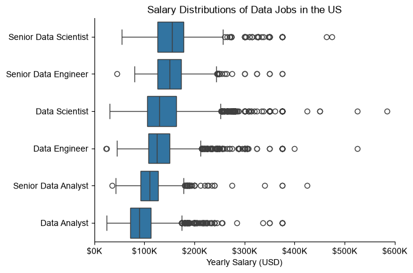
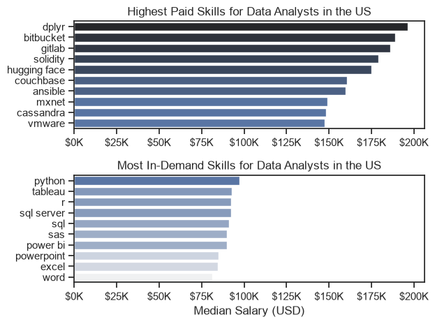
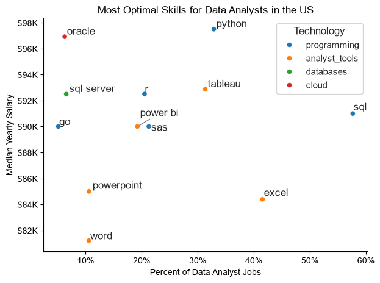

# Overview

Welcome to my analysis of the data job market, focusing on data analyst roles. This project was created out of a desire to navigate and understand the job market more effectively. It delves into the top-paying and in-demand skills to help find optimal job opportunities for data analysts.

The data sourced from [Luke Barousse's Python Course](https://lukebarousse.com/python) which provides a foundation for my analysis, containing detailed information on job titles, salaries, locations, and essential skills. Through a series of Python scripts, I explore key questions such as the most demanded skills, salary trends, and the intersection of demand and salary in data analytics.

# The Questions

Below are the questions I want to answer in my project:

1. What are the skills most in demand for the top 3 most popular data roles?
2. How are in-demand skills trending for Data Analysts?
3. How well do jobs and skills pay for Data Analysts?
4. What are the optimal skills for data analysts to learn? (High Demand AND High Paying) 

# Tools I Used

For my deep dive into the data analyst job market, I harnessed the power of several key tools:

- **Python:** The backbone of my analysis, allowing me to analyze the data and find critical insights. I also used the following Python libraries:
    - **Pandas Library:** This was used to analyze the data. 
    - **Matplotlib Library:** I visualized the data.
    - **Seaborn Library:** Helped me create more advanced visuals. 
- **Jupyter Notebooks:** The tool I used to run my Python scripts which let me easily include my notes and analysis.
- **Visual Studio Code:** My go-to for executing my Python scripts.
- **Git & GitHub:** Essential for version control and sharing my Python code and analysis, ensuring collaboration and project tracking.

# Data Preparation and Cleanup

This section outlines the steps taken to prepare the data for analysis, ensuring accuracy and usability.

## Import & Clean Up Data

I start by importing necessary libraries and loading the dataset, followed by initial data cleaning tasks to ensure data quality.

```python
# Importing Libraries
import ast
import pandas as pd
import seaborn as sns
from datasets import load_dataset
import matplotlib.pyplot as plt  

# Loading Data
dataset = load_dataset('lukebarousse/data_jobs')
df = dataset['train'].to_pandas()

# Data Cleanup
df['job_posted_date'] = pd.to_datetime(df['job_posted_date'])
df['job_skills'] = df['job_skills'].apply(lambda x: ast.literal_eval(x) if pd.notna(x) else x)
```

## Filter US Jobs

To focus my analysis on the U.S. job market, I apply filters to the dataset, narrowing down to roles based in the United States.

```python
df_US = df[df['job_country'] == 'United States']

```

# The Analysis

Each Jupyter notebook for this project aimed at investigating specific aspects of the data job market. Here’s how I approached each question:

## 1. Exploratory Data Analysis (EDA)

Before diving into the detailed analysis, I performed an exploratory analysis of the dataset to understand the overall data job market. I examined job distributions across countries, companies, and job titles, as well as several characteristics of job postings.

View my notebook with detailed steps here: [1_EDA](1_EDA.ipynb).

### 1. Global Job Market Overview

I started by identifying the countries and companies with the highest number of job postings. I also examined the distribution of job titles to understand which data-related roles were most common in the dataset.

### Visualize Data

```python
df_plot = df['job_country'].value_counts().head(20).rename_axis('job_country').reset_index(name='count')

sns.set_theme(style='ticks')
sns.barplot(data=df_plot, x='count', y='job_country', hue='count', palette='dark:b_r', legend=False)
sns.despine()
plt.title('Number of Jobs per Country')
plt.xlabel('Number of Jobs')
plt.ylabel('')
plt.show()
```

### Results


*Bar graph visualizing the job count per country.*

#### Key Insights

- The United States leads the dataset with 206,292 job postings, followed by India (51,088) and the United Kingdom (40,375).
- Other countries with substantial job-posting volumes include France (39,922), Germany (27,694), Spain (25,100), and Singapore (23,696).
- Booz Allen Hamilton (2,879), Dice (2,827), and Harnham (2,547) are among the companies with the highest number of job postings.
- Data Analyst positions are the most common role, with 196,075 postings, followed by Data Engineer (186,241) and Data Scientist (172,286).
- These three roles account for a substantial portion of the data-related job postings in the dataset.

### 2. General Job Posting Characteristics

I examined three characteristics across all job postings: remote-work availability, whether a degree requirement was mentioned, and whether health insurance was offered.

### Visualize Data

```python
dict_column = {
    'job_work_from_home': 'Work from Home Offered',
    'job_no_degree_mention': 'Degree Requirement',
    'job_health_insurance': 'Health Insurance Offered'
}

fig, ax = plt.subplots(1, 3, figsize=(11, 3.5))

for i, (column, title) in enumerate(dict_column.items()):
    ax[i].pie(df[column].value_counts(), labels=['False', 'True'], autopct='%1.1f%%', startangle=90)
    ax[i].set_title(title)

plt.show()
```

### Results


*Pie Chart visualizing the three characteristics like Work from home, no degree requirement, Health insurance offered.*

#### Key Insights

- Only 8.9% of job postings indicate that work from home is offered.
- In 30.6% of postings, no degree requirement is mentioned.
- Health insurance is explicitly offered in 11.0% of job postings.

These results provide a general overview of the employment conditions represented in the dataset.

### 3. Comparing Data Analyst and Data Engineer Opportunities in the US

Since Data Analyst and Data Engineer are two of the main roles I am interested in, I decided to examine their differences in the US job market more closely.

I compared the top 10 job locations and companies for each role, as well as three job-posting characteristics: remote-work availability, degree mentions, and health insurance benefits.

#### Job Locations

The analysis shows that "Anywhere" is the most common location for both roles, with 6,285 Data Engineer postings and 5,106 Data Analyst postings.

### Visualize Data

```python
fig, ax = plt.subplots(2, 1, figsize=(12, 10))
sns.set_theme(style='ticks')

df_plot_de = (
    df_de_us['job_location']
    .value_counts()
    .head(10)
    .rename_axis('job_location')
    .reset_index(name='count')
)

sns.barplot(
    data=df_plot_de,
    x='count',
    y='job_location',
    hue='count',
    palette='dark:b_r',
    legend=False,
    ax=ax[0]
)

ax[0].set_title('Top 10 Job Locations for Data Engineers in the US')
ax[0].set_xlabel('Number of Jobs')
ax[0].set_ylabel('')
ax[0].set_xlim(0, 6000)

df_plot_da = (
    df_da_us['job_location']
    .value_counts()
    .head(10)
    .rename_axis('job_location')
    .reset_index(name='count')
)

sns.barplot(
    data=df_plot_da,
    x='count',
    y='job_location',
    hue='count',
    palette='dark:b_r',
    legend=False,
    ax=ax[1]
)

ax[1].set_title('Top 10 Job Locations for Data Analysts in the US')
ax[1].set_xlabel('Number of Jobs')
ax[1].set_ylabel('')
ax[1].set_xlim(0, 6000)

sns.despine()
plt.tight_layout()
plt.show()

```

### Results


*bar Chart visualizing the top 10 location in the US for data analysis and data engineering job posts.*

Among specific cities:

- New York is the most frequently listed location for both roles, with 1,212 Data Engineer postings and 3,035 Data Analyst postings.
- Data Analyst postings show a higher concentration in several major US cities, including New York, Atlanta, Chicago, and Austin.
- Data Engineer postings also appear frequently in Dallas, Atlanta, Chicago, and Austin.

#### Companies

### Visualize Data

```python
fig, ax = plt.subplots(2, 1, figsize=(12, 10))
sns.set_theme(style='ticks')

df_plot_de = (
    df_de_us['company_name']
    .value_counts()
    .head(10)
    .rename_axis('company_name')
    .reset_index(name='count')
)

sns.barplot(
    data=df_plot_de,
    x='count',
    y='company_name',
    hue='count',
    palette='dark:b_r',
    legend=False,
    ax=ax[0]
)

ax[0].set_title('Counts of Companies for Data Engineers in the US')
ax[0].set_xlabel('Number of Jobs')
ax[0].set_ylabel('')
ax[0].set_xlim(0, 1100)

df_plot_da = (
    df_da_us['company_name']
    .value_counts()
    .head(10)
    .rename_axis('company_name')
    .reset_index(name='count')
)

sns.barplot(
    data=df_plot_da,
    x='count',
    y='company_name',
    hue='count',
    palette='dark:b_r',
    legend=False,
    ax=ax[1]
)

ax[1].set_title('Counts of Companies for Data Analyst in the US')
ax[1].set_xlabel('Number of Jobs')
ax[1].set_ylabel('')
ax[1].set_xlim(0, 1100)

sns.despine()
plt.tight_layout()
plt.show()

```

### Results


*Bar graphs visualizing the companies job posting count for DA vs DE job in the US.*

The companies with the highest number of postings differ between the two roles:

- For Data Analysts, Robert Half leads with 959 postings, followed by Insight Global (827) and Dice (584).
- For Data Engineers, Dice leads with 1,036 postings, followed by Capital One (628) and Booz Allen Hamilton (433).
- Several companies appear in the top 10 for both roles, including Dice, Insight Global, Robert Half, and Booz Allen Hamilton.

This suggests that some companies and recruitment organizations advertise opportunities across multiple data-related roles.

#### Comparing Job Posting Characteristics

### Visualize Data

```python
dict_column = {
    'job_work_from_home': 'Work from Home Offered',
    'job_no_degree_mention': 'Degree Requirement',
    'job_health_insurance': 'Health Insurance Offered'
}

fig, ax = plt.subplots(2, 3, figsize=(14, 9))

datasets = [df_de_us, df_da_us]
roles = ['Data Engineers', 'Data Analysts']

for row, (df_role, role) in enumerate(zip(datasets, roles)):
    for col, (column, title) in enumerate(dict_column.items()):
        counts = df_role[column].value_counts().reindex([False, True], fill_value=0)

        ax[row, col].pie(
            counts,
            labels=['False', 'True'],
            autopct='%1.1f%%',
            startangle=90
        )

        ax[row, col].set_title(title)

    ax[row, 0].text(
        -0.3, 0.5, role,
        transform=ax[row, 0].transAxes,
        rotation=90,
        va='center',
        fontsize=12
    )

plt.tight_layout()
plt.show()
```

### Results


*Pie Chart visualizing how job offerings differ between Data analysis and Data Engineering roles like Work from home, no degree mention, Health insurance offered.*

I also compared remote-work availability, degree mentions, and health insurance benefits between Data Analyst and Data Engineer postings.

The results revealed several differences:

- **Remote Work:** 17.9% of Data Engineer postings indicate that work from home is offered, compared to only 7.5% for Data Analyst postings. This suggests that remote-work opportunities are more frequently mentioned in Data Engineer job postings.
- **Degree Mentions:** 27.5% of Data Engineer postings and 28.0% of Data Analyst postings do not mention a degree requirement. The proportions are very similar between the two roles.
- **Health Insurance:** 33.9% of Data Engineer postings explicitly mention health insurance, compared to 35.5% of Data Analyst postings.

Overall, Data Engineer postings have a noticeably higher proportion of remote-work opportunities, while Data Analyst postings show slightly higher proportions of explicitly mentioned health insurance benefits. Degree-related mentions are nearly identical between the two roles.

## 2. What are the most demanded skills for the top 3 most popular data roles?

To find the most demanded skills for the top 3 most popular data roles. I filtered out those positions by which ones were the most popular, and got the top 5 skills for these top 3 roles. This query highlights the most popular job titles and their top skills, showing which skills I should pay attention to depending on the role I'm targeting. 

View my notebook with detailed steps here: [2_Skill_Demand](2_Skill_Demand.ipynb).

### Visualize Data

```python
fig, ax = plt.subplots(len(job_titles), 1)


for i, job_title in enumerate(job_titles):
    df_plot = df_skills_perc[df_skills_perc['job_title_short'] == job_title].head(5)[::-1]
    sns.barplot(data=df_plot, x='skill_percent', y='job_skills', ax=ax[i], hue='skill_count', palette='dark:b_r')

plt.show()
```

### Results


*Bar graph visualizing the salary for the top 3 data roles and their top 5 skills associated with each.*

### Insights:

- SQL is the most requested skill for Data Analysts and Data Scientists, with it in over half the job postings for both roles. For Data Engineers, Python is the most sought-after skill, appearing in 68% of job postings.
- Data Engineers require more specialized technical skills (AWS, Azure, Spark) compared to Data Analysts and Data Scientists who are expected to be proficient in more general data management and analysis tools (Excel, Tableau).
- Python is a versatile skill, highly demanded across all three roles, but most prominently for Data Scientists (72%) and Data Engineers (65%).

## 3. How are in-demand skills trending for Data Analysts?

To find how skills are trending in 2023 for Data Analysts, I filtered data analyst positions and grouped the skills by the month of the job postings. This got me the top 5 skills of data analysts by month, showing how popular skills were throughout 2023.

View my notebook with detailed steps here: [3_Skills_Trend](3_Skills_Trend.ipynb).

### Visualize Data

```python

from matplotlib.ticker import PercentFormatter

df_plot = df_DA_US_percent.iloc[:, :5]
sns.lineplot(data=df_plot, dashes=False, legend='full', palette='tab10')

plt.gca().yaxis.set_major_formatter(PercentFormatter(decimals=0))

plt.show()

```

### Results

  
*Line graph visualizing the trending top skills for data analysts in the US in 2023.*

### Insights:
- SQL remains the most consistently demanded skill throughout the year, although it shows a gradual decrease in demand.
- Excel experienced a significant increase in demand starting around September, surpassing both Python and Tableau by the end of the year.
- Both Python and Tableau show relatively stable demand throughout the year with some fluctuations but remain essential skills for data analysts. Power BI, while less demanded compared to the others, shows a slight upward trend towards the year's end.

## 4. How well do jobs and skills pay for Data Analysts?

To identify the highest-paying roles and skills, I only got jobs in the United States and looked at their median salary. But first I looked at the salary distributions of common data jobs like Data Scientist, Data Engineer, and Data Analyst, to get an idea of which jobs are paid the most. 

View my notebook with detailed steps here: [4_Salary_Analysis](4_Salary_Analysis.ipynb).

#### Visualize Data 

```python
sns.boxplot(data=df_US_top6, x='salary_year_avg', y='job_title_short', order=job_order)

ticks_x = plt.FuncFormatter(lambda y, pos: f'${int(y/1000)}K')
plt.gca().xaxis.set_major_formatter(ticks_x)
plt.show()

```

#### Results

  
*Box plot visualizing the salary distributions for the top 6 data job titles.*

#### Insights

- There's a significant variation in salary ranges across different job titles. Senior Data Scientist positions tend to have the highest salary potential, with up to $600K, indicating the high value placed on advanced data skills and experience in the industry.

- Senior Data Engineer and Senior Data Scientist roles show a considerable number of outliers on the higher end of the salary spectrum, suggesting that exceptional skills or circumstances can lead to high pay in these roles. In contrast, Data Analyst roles demonstrate more consistency in salary, with fewer outliers.

- The median salaries increase with the seniority and specialization of the roles. Senior roles (Senior Data Scientist, Senior Data Engineer) not only have higher median salaries but also larger differences in typical salaries, reflecting greater variance in compensation as responsibilities increase.

### Highest Paid & Most Demanded Skills for Data Analysts

Next, I narrowed my analysis and focused only on data analyst roles. I looked at the highest-paid skills and the most in-demand skills. I used two bar charts to showcase these.

#### Visualize Data

```python

fig, ax = plt.subplots(2, 1)  

# Top 10 Highest Paid Skills for Data Analysts
sns.barplot(data=df_DA_top_pay, x='median', y=df_DA_top_pay.index, hue='median', ax=ax[0], palette='dark:b_r')

# Top 10 Most In-Demand Skills for Data Analysts')
sns.barplot(data=df_DA_skills, x='median', y=df_DA_skills.index, hue='median', ax=ax[1], palette='light:b')

plt.show()

```

#### Results
Here's the breakdown of the highest-paid & most in-demand skills for data analysts in the US:


*Two separate bar graphs visualizing the highest paid skills and most in-demand skills for data analysts in the US.*

#### Insights:

- The top graph shows specialized technical skills like `dplyr`, `Bitbucket`, and `Gitlab` are associated with higher salaries, some reaching up to $200K, suggesting that advanced technical proficiency can increase earning potential.

- The bottom graph highlights that foundational skills like `Excel`, `PowerPoint`, and `SQL` are the most in-demand, even though they may not offer the highest salaries. This demonstrates the importance of these core skills for employability in data analysis roles.

- There's a clear distinction between the skills that are highest paid and those that are most in-demand. Data analysts aiming to maximize their career potential should consider developing a diverse skill set that includes both high-paying specialized skills and widely demanded foundational skills.

## 5. What are the most optimal skills to learn for Data Analysts?

To identify the most optimal skills to learn ( the ones that are the highest paid and highest in demand) I calculated the percent of skill demand and the median salary of these skills. To easily identify which are the most optimal skills to learn. 

View my notebook with detailed steps here: [5_Optimal_Skills](5_Optimal_Skills.ipynb).

#### Visualize Data

```python
from adjustText import adjust_text
import matplotlib.pyplot as plt

plt.scatter(df_DA_skills_high_demand['skill_percent'], df_DA_skills_high_demand['median_salary'])
plt.show()

```

#### Results

    
*A scatter plot visualizing the most optimal skills (high paying & high demand) for data analysts in the US.*

#### Insights:

- The skill `Oracle` appears to have the highest median salary of nearly $97K, despite being less common in job postings. This suggests a high value placed on specialized database skills within the data analyst profession.

- More commonly required skills like `Excel` and `SQL` have a large presence in job listings but lower median salaries compared to specialized skills like `Python` and `Tableau`, which not only have higher salaries but are also moderately prevalent in job listings.

- Skills such as `Python`, `Tableau`, and `SQL Server` are towards the higher end of the salary spectrum while also being fairly common in job listings, indicating that proficiency in these tools can lead to good opportunities in data analytics.

### Visualizing Different Technologies

Let's visualize the different technologies as well in the graph. We'll add color labels based on the technology (e.g., {Programming: Python})

#### Visualize Data

```python
from matplotlib.ticker import PercentFormatter

# Create a scatter plot
scatter = sns.scatterplot(
    data=df_DA_skills_tech_high_demand,
    x='skill_percent',
    y='median_salary',
    hue='technology',  # Color by technology
    palette='bright',  # Use a bright palette for distinct colors
    legend='full'  # Ensure the legend is shown
)
plt.show()

```

#### Results

  
*A scatter plot visualizing the most optimal skills (high paying & high demand) for data analysts in the US with color labels for technology.*

#### Insights:

- The scatter plot shows that most of the `programming` skills (colored blue) tend to cluster at higher salary levels compared to other categories, indicating that programming expertise might offer greater salary benefits within the data analytics field.

- The database skills (colored orange), such as Oracle and SQL Server, are associated with some of the highest salaries among data analyst tools. This indicates a significant demand and valuation for data management and manipulation expertise in the industry.

- Analyst tools (colored green), including Tableau and Power BI, are prevalent in job postings and offer competitive salaries, showing that visualization and data analysis software are crucial for current data roles. This category not only has good salaries but is also versatile across different types of data tasks.


# What I Learned

Throughout this project, I deepened my understanding of the data analyst job market and enhanced my technical skills in Python, especially in data manipulation and visualization. Here are a few specific things I learned:

- **Advanced Python Usage**: Utilizing libraries such as Pandas for data manipulation, Seaborn and Matplotlib for data visualization, and other libraries helped me perform complex data analysis tasks more efficiently.
- **Data Cleaning Importance**: I learned that thorough data cleaning and preparation are crucial before any analysis can be conducted, ensuring the accuracy of insights derived from the data.
- **Strategic Skill Analysis**: The project emphasized the importance of aligning one's skills with market demand. Understanding the relationship between skill demand, salary, and job availability allows for more strategic career planning in the tech industry.


# Insights

This project provided several general insights into the data job market for analysts:

- **Skill Demand and Salary Correlation**: There is a clear correlation between the demand for specific skills and the salaries these skills command. Advanced and specialized skills like Python and Oracle often lead to higher salaries.
- **Market Trends**: There are changing trends in skill demand, highlighting the dynamic nature of the data job market. Keeping up with these trends is essential for career growth in data analytics.
- **Economic Value of Skills**: Understanding which skills are both in-demand and well-compensated can guide data analysts in prioritizing learning to maximize their economic returns.


# Challenges I Faced

This project was not without its challenges, but it provided good learning opportunities:

- **Data Inconsistencies**: Handling missing or inconsistent data entries requires careful consideration and thorough data-cleaning techniques to ensure the integrity of the analysis.
- **Complex Data Visualization**: Designing effective visual representations of complex datasets was challenging but critical for conveying insights clearly and compellingly.
- **Balancing Breadth and Depth**: Deciding how deeply to dive into each analysis while maintaining a broad overview of the data landscape required constant balancing to ensure comprehensive coverage without getting lost in details.


# Conclusion

This exploration into the data analyst job market has been incredibly informative, highlighting the critical skills and trends that shape this evolving field. The insights I got enhance my understanding and provide actionable guidance for anyone looking to advance their career in data analytics. As the market continues to change, ongoing analysis will be essential to stay ahead in data analytics. This project is a good foundation for future explorations and underscores the importance of continuous learning and adaptation in the data field.

